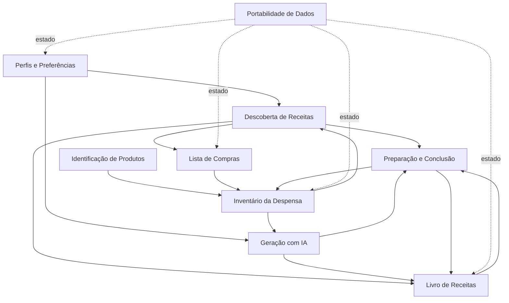

# 03 — Domínios e responsabilidades

> **[PROPOSTA]** Esta é uma separação lógica para discutir o desenho da aplicação. **Não** implica microserviços, APIs HTTP próprias, múltiplas bases de dados ou diferentes equipas.

## Mapa de domínios

| Domínio / módulo lógico | Responsabilidade principal | Conceitos próprios | Requisitos relacionados |
|---|---|---|---|
| **Perfis e Preferências** | Gerir perfis, selecionar perfil ativo e expor restrições alimentares/porções. | Perfil, preferências, alergénios, exclusões | `RF-PER-*` |
| **Inventário da Despensa** | Gerir stock, categorias, unidades, validades e alertas. | Artigo de despensa, categoria, quantidade | `RF-PAN-*` |
| **Identificação de Produtos** | Obter metadados de produtos por código de barras e apoiar preenchimento. | Código de barras, resultado de consulta | `RF-PROD-*` |
| **Descoberta de Receitas** | Encontrar receitas externas, aplicar compatibilidade e cruzar ingredientes com stock. | Receita candidata, ingredientes disponíveis/em falta, percentagem de correspondência | `RF-DESC-*` |
| **Livro de Receitas** | Guardar receitas, organizar em coleções/pastas e manter contador. | Receita guardada, coleção, pasta, contador | `RF-LIB-*` |
| **Geração de Receitas com IA** | Preparar contexto e interpretar receitas geradas. | Pedido de geração, receita gerada | `RF-AI-*` |
| **Preparação e Conclusão** | Executar passos/temporizadores e confirmar consumos/conclusão. | Passo de receita, temporizador, resumo de consumo | `RF-COOK-*`, `RF-MEAL-*` |
| **Lista de Compras** | Gerir artigos necessários e transferir compras para o inventário. | Artigo de compra, estado comprado | `RF-SHOP-*` |
| **Portabilidade de Dados** | Exportar, importar, substituir e fundir estado. | Snapshot JSON, política de importação | `RF-DATA-*` |

## Domínios centrais e de suporte — proposta

- **Centrais:** Inventário da Despensa; Descoberta de Receitas; Preparação e Conclusão.
- **De suporte:** Perfis e Preferências; Livro de Receitas; Geração de Receitas com IA; Lista de Compras; Identificação de Produtos; Portabilidade de Dados.

Esta classificação serve apenas para apoiar prioridades e fronteiras de responsabilidade; não é uma exigência do enunciado.

## Interações entre domínios

A passagem **Inventário → Geração com IA** é desencadeada pela seleção de sobras; o envio ao fornecedor contém apenas os ingredientes escolhidos e o perfil ativo (não é obrigatório enviar o inventário inteiro).

## Fronteiras de responsabilidade sugeridas

### Perfis e Preferências

- É fonte de verdade para o **perfil ativo** e respetivas restrições.
- Não possui um inventário ou livro de receitas por perfil: esses dados são partilhados.

### Inventário da Despensa

- É fonte de verdade para existências, medidas e validades.
- Recebe entradas via formulário, consulta de produtos ou compras transferidas.
- Só desconta consumos depois da confirmação na conclusão da refeição.

### Descoberta e Geração de Receitas

- Podem partilhar um **modelo lógico de Receita**, mas têm origens distintas (catálogo vs. IA).
- Consomem preferências do perfil ativo.
- A descoberta faz correspondência com o stock; a IA usa as sobras selecionadas.

### Preparação e Conclusão

- A navegação entre passos e os temporizadores pertencem ao fluxo de cozinhar.
- O **desconto confirmado** é delegado ao inventário; a contagem de preparações afeta o livro de receitas.

### Portabilidade

- Atua sobre o estado completo da aplicação, sem decidir por si as regras de negócio de cada domínio.

## Pontos a validar antes de implementar

- `Q-01` Definição de ingrediente e equivalências entre catálogo, IA e inventário.
- `Q-03` Receita comum: esquema mínimo para catálogo, IA e armazenamento offline.
- `Q-08` Persistência local e limites de offline.
- `Q-09` Relação entre coleções e pastas.
- `Q-10` Comportamento do contador para receitas ainda não guardadas.
- `Q-12` Estratégia de fusão/importação entre entidades.
