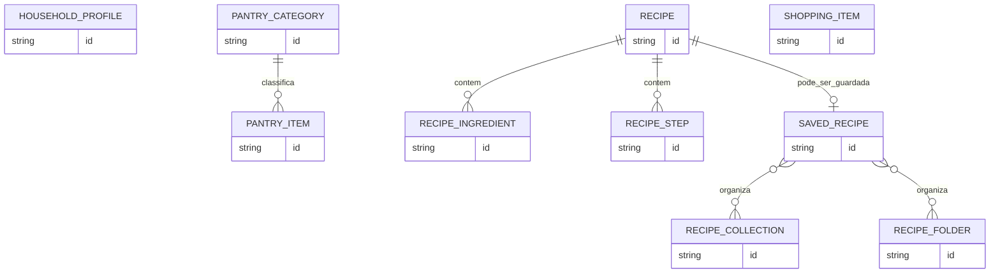

# 04 — Modelo de dados (conceptual)

> **Estado:** proposta de entidades e relações extraída das funcionalidades. Sem SQL, tipos concretos, chaves definitivas ou tecnologia de persistência escolhida.  
> **Legenda:** **[E]** atributo explicitamente mencionado; **[P]** atributo/estrutura técnico(a) proposto(a); **[?]** detalhe por definir.

## Entidades candidatas

### 1. Perfil (`HouseholdProfile`)

| Atributo | Estado | Observação |
|---|---|---|
| Identificador | [P] | Necessário para distinguir perfis. |
| Nome/descrição do perfil | [?] | A seleção de perfis sugere uma identificação visível; não é especificado. |
| Número habitual de porções | [E] | Configurado no onboarding e editável nas definições. |
| Estilos alimentares | [E] | Ex.: vegetariano, vegan. |
| Alergias / alergénios | [E] | Usados nos filtros e nas sugestões de IA. |
| Ingredientes excluídos | [E] | Usados nos filtros e nas sugestões de IA. |

**Estado global associado:** referência ao *perfil ativo* **[E]**. A forma de o persistir é **[P]**.

### 2. Categoria (`PantryCategory`)

| Atributo | Estado | Observação |
|---|---|---|
| Identificador | [P] | Referência a partir dos artigos. |
| Nome | [E] | Categorias comuns ou personalizadas. |
| Origem/tipo (comum ou personalizada) | [P] | Útil para exportar as categorias personalizadas. |

### 3. Artigo de despensa (`PantryItem`)

| Atributo | Estado | Observação |
|---|---|---|
| Identificador | [P] | Permite gerir entradas individuais. |
| Nome | [E] | Produto ou ingrediente. |
| Categoria | [E] | Categoria de armazenamento. |
| Quantidade | [E] | Quantidade atualmente disponível. |
| Unidade | [E] | Ex.: unidade de medida; valores permitidos por definir. |
| Data de validade | [E] | Suporta o alerta das 48 horas. |
| Código de barras | [?] | Usado na consulta, mas guardar na despensa não é exigido. |

**Atenção:** o enunciado não define se o mesmo produto pode ter várias entradas/lotes com validades diferentes; ver `Q-02`.

### 4. Receita (`Recipe`)

Modelo de referência comum para receitas de catálogo, IA e guardadas.

| Atributo | Estado | Observação |
|---|---|---|
| Identificador local | [P] | Identificação de receitas persistidas. |
| Origem (catálogo/IA) | [P] | Distinção necessária para manter proveniência. |
| Identificador externo | [?] | Aplicável a catálogos se disponível. |
| Título/nome | [P] | Implícito na apresentação de receitas. |
| Porções | [E] | Explicitamente na receita gerada e no contexto de perfil. |
| Tempos de preparação | [E] | Explicitamente para a receita IA. |
| Ingredientes e respetivas medidas | [E] | Necessários para correspondência, Cook Mode e consumos. |
| Passos ordenados de preparação | [E] | Necessários para Cook Mode; explícitos na geração IA. |

**[POR DEFINIR]** Quais os campos que a API de catálogo garante, que dados são armazenados localmente e como uniformizar respostas externas (`Q-03`).

### 5. Ingrediente de receita (`RecipeIngredient`)

| Atributo | Estado | Observação |
|---|---|---|
| Referência à receita | [P] | Relação com `Recipe`. |
| Nome do ingrediente | [E] | Comparação com despensa, restrições e compras. |
| Quantidade | [E] | Medidas utilizadas na receita/consumo. |
| Unidade | [E] | Medida apresentada ao utilizador. |
| Identificador normalizado | [?] | Possível estratégia para comparar nomes diferentes. |

### 6. Passo da receita (`RecipeStep`)

| Atributo | Estado | Observação |
|---|---|---|
| Ordem | [E] | Carrossel sequencial. |
| Instrução | [E] | Texto do passo. |
| Ingredientes e medidas usados no passo | [E] | Apenas os do passo ativo são destacados. |
| Duração/temporizador associado | [?] | O Cook Mode permite temporizadores; associação exata não é especificada. |

### 7. Receita guardada (`SavedRecipe`)

| Atributo | Estado | Observação |
|---|---|---|
| Referência/conteúdo da receita | [E] | Guardada no livro para acesso e consulta offline. |
| Número de preparações | [E] | Contador apresentado e incrementado após conclusão. |
| Coleções / pastas atribuídas | [E] | Organização personalizada; cardinalidade por definir. |

**[PROPOSTA]** Separar `Recipe` e `SavedRecipe` pode ajudar a distinguir receitas apenas encontradas de receitas guardadas; não é obrigatório que sejam tabelas/objetos diferentes.

### 8. Organização de receitas (`RecipeCollection` / `RecipeFolder`)

**[E]** O utilizador pode criar **coleções e pastas** para organizar receitas favoritas. A hierarquia, existência de pastas dentro de coleções e relação N:N com receitas **não são definidas** (`Q-09`).

### 9. Artigo de compras (`ShoppingItem`)

| Atributo | Estado | Observação |
|---|---|---|
| Identificador | [P] | Necessário para seleção individual. |
| Nome do artigo/ingrediente | [E] | Adicionado manualmente ou a partir de receita. |
| Estado assinalado/comprado | [E] | Permite transferência em lote de artigos marcados. |
| Quantidade/unidade pretendidas | [?] | Podem vir da receita; o enunciado exige poder definir quantidades ao transferir. |
| Categoria e validade para a despensa | [E] | São definidas pelo utilizador no momento da transferência. |

## Objetos de operação / não necessariamente persistidos

- **`ProductLookupResult` [P]:** nome, categoria e tamanho padrão obtidos por consulta externa para pré-preencher formulário.
- **`RecipeMatch` [P]:** receita candidata, percentagem de correspondência, ingredientes disponíveis e em falta, eventual prioridade por validade.
- **`GenerationRequest` [P]:** sobras selecionadas + restrições + porções do perfil ativo.
- **`CookingSession` [P]:** passo ativo e estado dos temporizadores durante o Cook Mode. Persistência não exigida.
- **`ConsumptionSummary` [P]:** quantidades a confirmar/ajustar antes de descontar stock.
- **`AppSnapshot` [P]:** representação JSON do estado da aplicação para exportação/importação.

## Relações conceptuais

> O diagrama é **ilustrativo**: os campos `id`, a cardinalidade das coleções/pastas e a separação entre `Recipe`/`SavedRecipe` são propostas. `HouseholdProfile` e `ShoppingItem` aparecem sem ligações de posse porque perfis não são donos de despensas/listas individuais. **Não** interpretar o desenho como esquema definitivo.

## Restrições conhecidas e detalhes por definir

- O inventário, a lista de compras e o livro de receitas pertencem ao **estado partilhado** e não a um perfil específico.
- Quantidade e unidade devem permanecer associadas, incluindo no processo de consumo e transferência de compras.
- A validade é usada para calcular proximidade do prazo (48 h); fuso horário, precisão e estado de produtos já expirados exigem decisão (`Q-04`).
- O acesso offline às receitas guardadas requer dados suficientes para mostrar detalhes e cozinhar; o esquema persistido concreto não foi prescrito.
- Exportação/importação abrangem as entidades persistidas e estado relevante, mas o esquema JSON e resolução de conflitos não estão definidos (`Q-12`).
