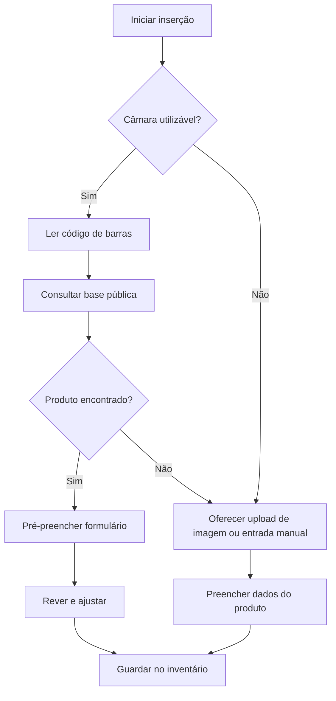

# 06 — Integrações e capacidades do dispositivo

## Matriz de integrações

| Integração/capacidade | Tipo | Finalidade | Comportamento exigido / fallback | Estado |
|---|---|---|---|---|
| Câmara do dispositivo | Hardware/API do dispositivo | Ler códigos de barras de produtos | Com permissão negada, não suportada ou sem resultado: oferecer imagem ou entrada manual | [EXPLÍCITO] |
| Base de dados pública de produtos | Serviço externo | Devolver nome, categoria, tamanho padrão | Produto não encontrado deve permitir alternativa ao scan | [EXPLÍCITO] |
| Seleção/carregamento de imagem | API do dispositivo / ficheiros | Alternativa de inserção de produto | Upload de imagem disponível no fallback; processamento não descrito | [EXPLÍCITO] |
| API pública de receitas | Serviço externo | Pesquisar receitas de catálogo | Respostas usadas para filtros e correspondência; fornecedor por escolher | [EXPLÍCITO] |
| API GenAI | Serviço externo | Gerar receita original estruturada | Entrada respeita ingredientes selecionados e perfil ativo; fornecedor por escolher | [EXPLÍCITO] |
| Temporizadores da aplicação | Capacidade local | Contagem decrescente durante Cook Mode | Iniciar, pausar, repor e alertar visualmente ao terminar | [EXPLÍCITO] |
| Armazenamento de receitas para acesso offline | Persistência local/capacidade offline | Ler receitas guardadas sem rede | Receitas guardadas acessíveis offline; tecnologia por escolher | [EXPLÍCITO] |
| Leitura/escrita de ficheiros JSON | API de ficheiros/partilha do dispositivo | Exportação e importação de estado | Modos overwrite e merge na importação | [EXPLÍCITO] |

## Fluxo 1 — Inserção por código de barras

**Nota:** o tratamento de falha de rede e o significado técnico de upload de imagem ainda carecem de decisão.

## Fluxo 2 — Fontes de receitas

- **Catálogo:** API de receitas → compatibilidade do perfil → correspondência com inventário → receita apresentada → lista de compras ou Cook Mode/livro.
- **IA:** ingredientes selecionados + perfil ativo → API GenAI → receita estruturada → Cook Mode/livro.

## Fluxo 3 — Dados locais e portabilidade

- O estado persistido da aplicação alimenta as vistas partilhadas (perfis, inventário, compras e livro).
- A exportação cria um ficheiro JSON estruturado com o estado relevante.
- A importação aceita substituição ou fusão.

**[POR DEFINIR]** Storage engine, localização dos ficheiros, versão do esquema e política de conflitos na fusão. Estes detalhes não fazem parte dos requisitos originais.

## Dependência de conectividade

**[EXPLÍCITO]** As receitas **guardadas** estão disponíveis offline e não existe backend obrigatório.  
**[INFERÊNCIA TÉCNICA]** Pesquisa remota de produtos/receitas e geração por IA necessitam de ligação à rede, salvo mecanismos de cache ou modelos locais não exigidos. Portanto, “autónoma no dispositivo” **não** significa necessariamente “todas as funções offline”.

## Questões relacionadas

`Q-06` upload de imagem · `Q-07` fornecedores · `Q-08` armazenamento/offline · `Q-13` temporizadores em segundo plano · `Q-15` indisponibilidade da rede/APIs.
