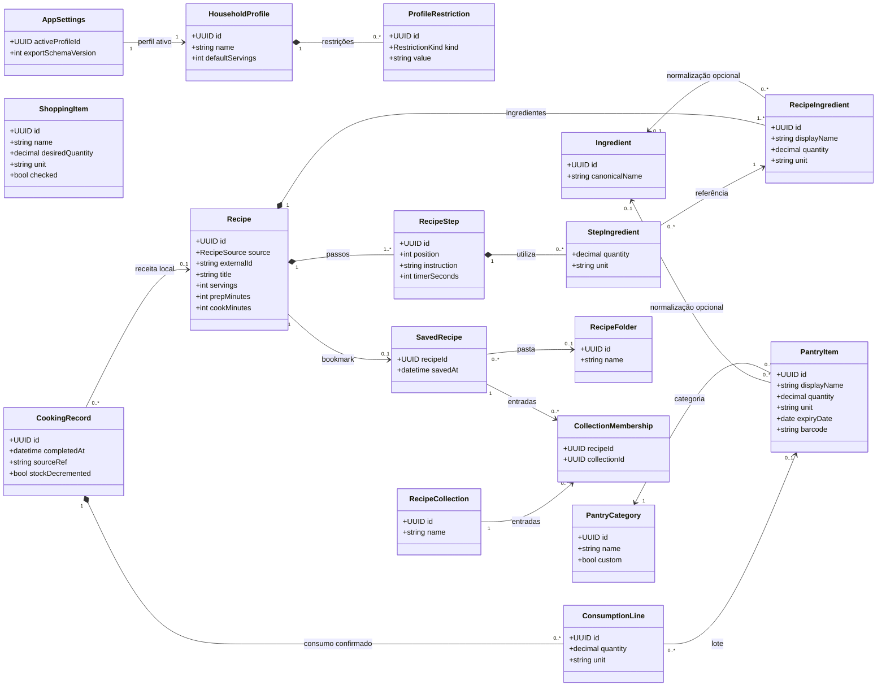

# UML — Diagrama de classes do domínio

**Estado:** proposta para discussão (não corresponde a código escrito ou a um esquema aprovado).

- Classes são **conceitos de negócio**; nem todas terão uma tabela independente.
- `HouseholdProfile` representa um **perfil alimentar dentro da mesma aplicação**, não uma despensa individual.
- `Recipe` representa a receita canónica, quer venha de um catálogo, quer de IA. Uma receita de catálogo encontrada **não fica automaticamente persistida**.
- `CookingRecord` mantém a conclusão de uma preparação, permitindo contar preparações mesmo que a receita não seja guardada, desde que a identificação da receita seja estável.
- `ConsumptionLine` modela a quantidade confirmada por lote. A regra de stock pode usar FEFO (*first expiring, first out*), mas não foi determinada pelo enunciado.

## Comportamentos importantes (classes de serviço, não entidades)

| Serviço ou operação | Responsabilidade |
|---|---|
| `ProfileService.selectActiveProfile()` | Alterar o perfil ativo sem alterar a despensa partilhada |
| `PantryService.addItem()` | Validar quantidade, unidade, categoria e validade |
| `RecipeMatcher.match()` | Normalizar ingredientes, calcular sobreposição e indicar faltas |
| `RecipeCompatibilityPolicy.evaluate()` | Aplicar estilos alimentares, alergénios e exclusões sem depender só de etiquetas externas |
| `RecipeGenerator.generate()` | Adaptar pedido e validar resposta estruturada do fornecedor de IA |
| `CookingService.completeMeal()` | Aplicar conclusão de modo idempotente, opcionalmente descontar stock e registar preparação |
| `ShoppingService.transferChecked()` | Transferir artigos selecionados para lotes da despensa sem duplicar em caso de repetição |
| `StateTransferService.import()/export()` | Validar versão, referencial e conflitos na exportação/importação JSON |

## Questões por resolver

1. `ProfileRestriction`: enum com `LIFESTYLE`, `ALLERGEN`, `EXCLUDED_INGREDIENT`, ou tabelas separadas?
2. O mesmo produto pode ter lotes diferentes? **Recomendado** modelar cada lote como `PantryItem` individual.
3. `RecipeFolder` e `RecipeCollection` são dois tipos distintos ou um único conceito hierárquico?
4. Uma receita de catálogo só pode ser guardada offline se a **licença/termos da API** permitirem tal persistência.
5. Se `expiryDate` tiver apenas dia, como interpretar o alerta de 48 horas? Decidir sem introduzir precisão artificial.
6. Como identificar uma preparação de receita externa não guardada? `sourceRef` e `externalId` quando disponíveis.
