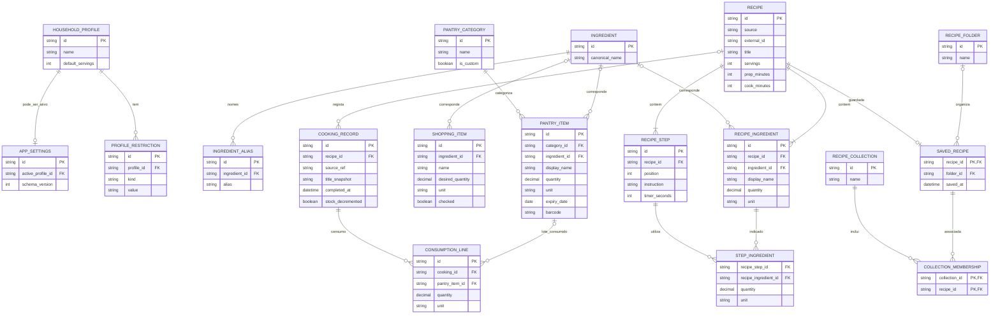

# ER — Modelo lógico candidato para persistência local

> **Proposta, não esquema final.** A tecnologia (SQLite, IndexedDB, outra) não foi escolhida. `PK` = chave primária; `FK` = chave estrangeira. A base de dados persiste **dados partilhados numa única instalação**, não bases separadas por perfil.

## Núcleo recomendado para um primeiro sprint

1. `HOUSEHOLD_PROFILE`, `PROFILE_RESTRICTION`, `APP_SETTINGS` (onboarding e seleção de perfil).
2. `PANTRY_CATEGORY`, `PANTRY_ITEM` (despensa, expirados, categorias personalizadas).
3. `SHOPPING_ITEM` (lista e transferência).
4. `RECIPE`, `RECIPE_INGREDIENT`, `RECIPE_STEP`, `SAVED_RECIPE` (apenas receitas cuja persistência é permitida).

Os restantes conjuntos de tabelas suportam fluxos mais avançados, e podem evoluir conforme a validação com o Product Owner. `INGREDIENT` e `INGREDIENT_ALIAS` são recomendados para normalização, mas inicialmente podem ser substituídos por um identificador/serviço local simples. `STEP_INGREDIENT` permite mostrar apenas as medidas do passo ativo.

## Restrições de integridade sugeridas

- Quantidades `>= 0` na despensa e `> 0` nas linhas de consumo/transação (a política de zero deve ser uniforme).
- `default_servings > 0`, `servings > 0`, durações de temporizador não negativas.
- `UNIQUE (recipe_id, position)` em `RECIPE_STEP`.
- `UNIQUE (collection_id, recipe_id)` em `COLLECTION_MEMBERSHIP`.
- Preservar relações na importação; nunca inserir associações com `FK` inexistente.
- Uso de transação local atómica para conclusão com desconto de stock.
- Importação/merge deve possuir versão de esquema e estratégia de conflitos.
- Não presumir que alergénios declarados por terceiros são completos; resultados incompletos devem ser tratados como **não verificados**.
