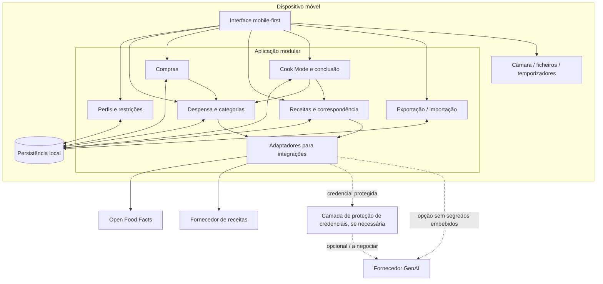

# UML/Componentes — Arquitetura lógica (independente da stack)

## Interpretação

- O modelo **não obriga** à criação de microserviços, servidor próprio, REST API interna ou várias bases de dados.
- A aplicação deve continuar funcional em fluxos locais mesmo sem rede; pesquisa e IA dependem da disponibilidade dos respetivos fornecedores, salvo alternativas específicas.
- A camada `SEC` **não está decidida**. APIs de IA com chaves privadas exigem uma solução de segurança aprovada: pequeno proxy/serverless, integração disponibilizada institucionalmente, ou outro mecanismo compatível com as regras do projeto.
- Scanning de código de barras é uma capacidade de **dispositivo/biblioteca**, distinta da consulta HTTP ao catálogo de produtos.
- Adaptadores isolam as diferenças entre APIs para que o modelo de `Recipe` seja estável.
