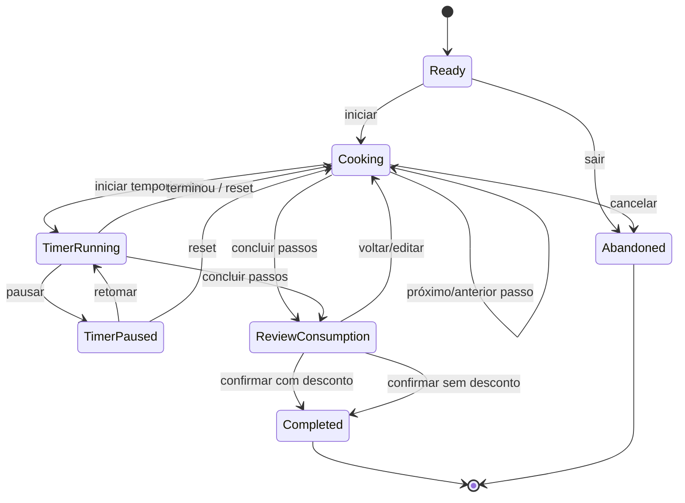

# UML/Estados — Sessão Cook Mode

`TimerRunning` é um estado UI temporário. Se os timers devem sobreviver ao fecho/reabertura da aplicação é uma decisão de requisitos ainda pendente (Q-13). O registo de conclusão só acontece ao entrar em `Completed`.
